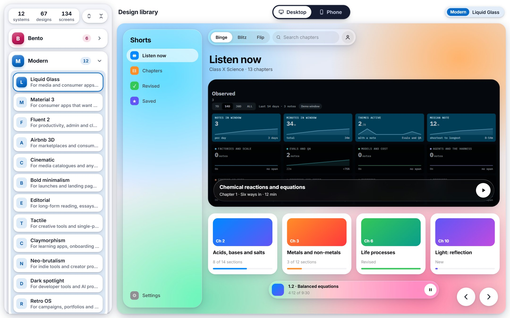
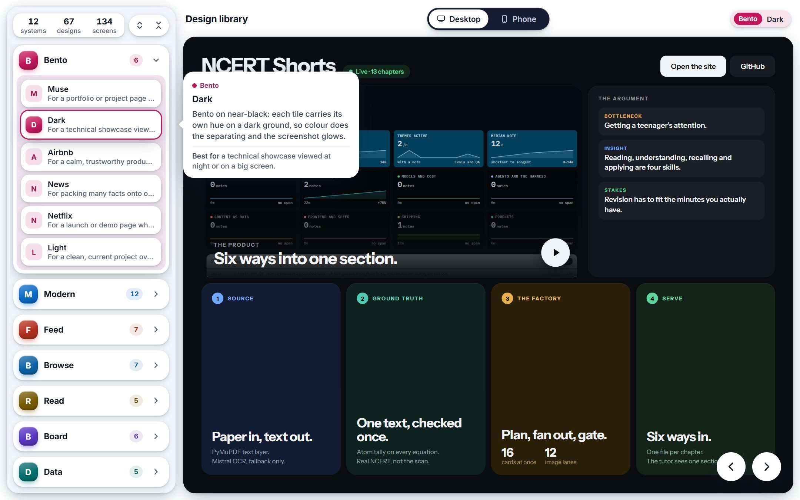
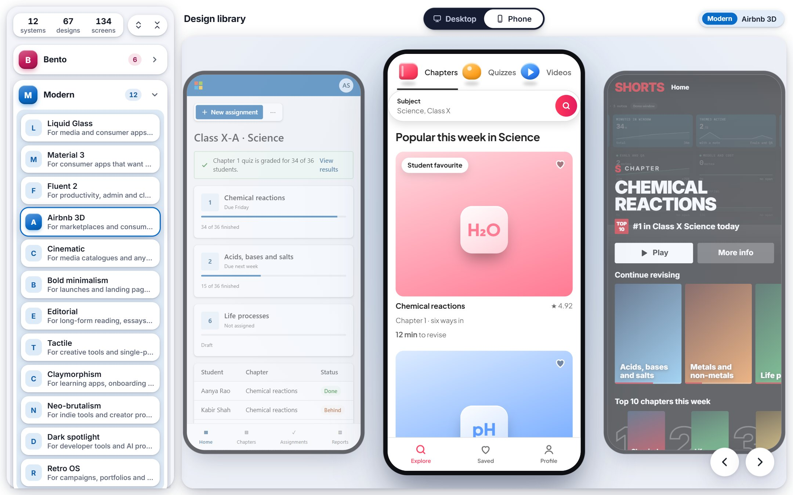
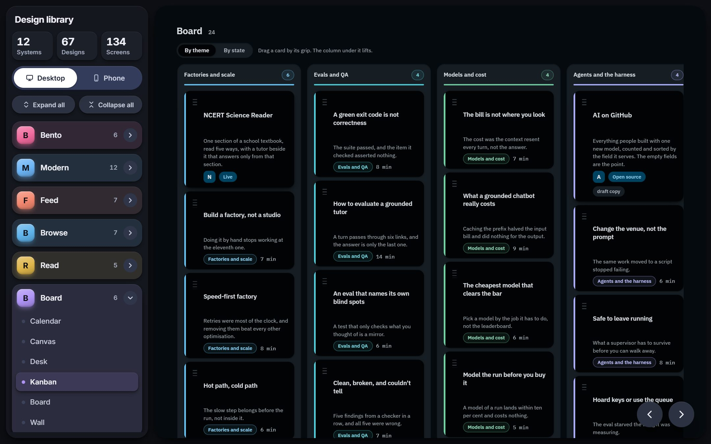
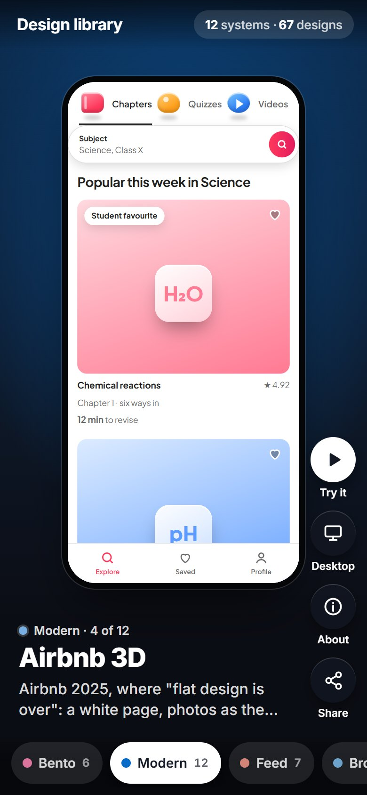
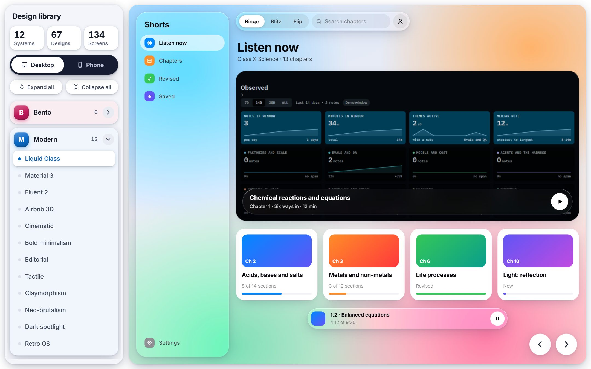
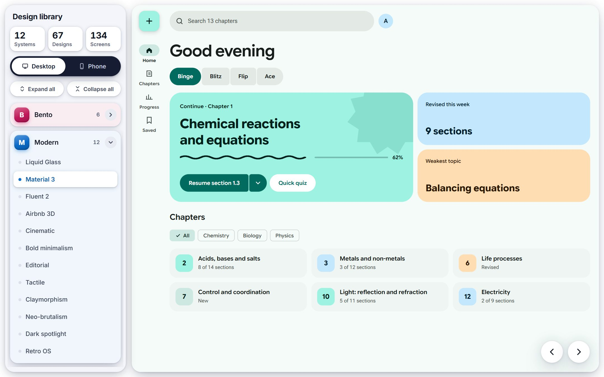
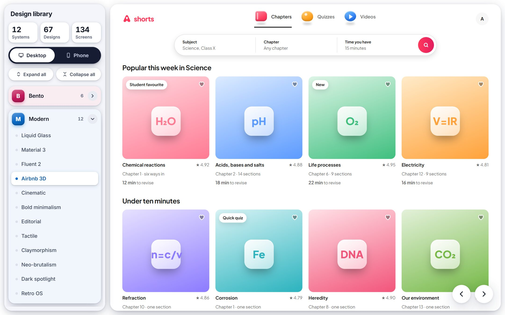

<div align="center">

# Design library

### Working screens to choose from before you build one

**[design.abbasshaheer.com](https://design.abbasshaheer.com)**

12 systems &nbsp;·&nbsp; 67 designs &nbsp;·&nbsp; 134 screens, each one running in a desktop and a phone layout &nbsp;·&nbsp; free to open, nothing to install

[Open it](#open-it) &nbsp;·&nbsp; [Why it exists](#the-same-four-decisions) &nbsp;·&nbsp; [What is inside](#what-is-inside) &nbsp;·&nbsp; [How to use it](#how-to-use-it) &nbsp;·&nbsp; [Modern designs](#the-modern-system) &nbsp;·&nbsp; [Requests](#requests) &nbsp;·&nbsp; [Questions](#questions)

<br>



</div>

<br>

## Open it

There is nothing to install and no account to make. Open the address on a laptop or a phone:

```text
https://design.abbasshaheer.com
```

Open a system on the left, pick one of its designs, and switch between **Desktop** and **Phone**.

## The same four decisions

Every new product screen starts with the same four questions: what shape is it, which parts does it need, how are they arranged, and what happens when someone touches it. Component kits answer none of them. They hand you five hundred parts and leave the shape to you.

> **A design is a skeleton plus a stated set of trade-offs. Choose the skeleton first and most of the decisions are already made.**

The library holds the skeletons, each one running. You look at the real thing, at its real size, and decide.

| With a component kit alone | With the library |
|---|---|
| Parts, and a blank page to arrange them on | Whole screens you can open, click and compare |
| A screenshot of what it might look like | The design itself, running, at desktop and phone width |
| Guessing when a pattern breaks | One or two sentences on what each design is for |
| Rebuilt from scratch on every project | Picked in minutes, then filled with your own data |

## What is inside

| System | What it is for | Designs |
|---|---|---|
| **Bento** | One project as a bento box, where tile size says what matters most, in six visual styles | Muse, Dark, Airbnb, News, Netflix, Light |
| **Modern** | Widely used design systems and visual trends, each rebuilt as a working screen | Liquid Glass, Material 3, Fluent 2, Airbnb 3D, Cinematic, Bold minimalism, Editorial, Tactile, Claymorphism, Neo-brutalism, Dark spotlight, Retro OS |
| **Feed** | One item at a time; the reader judges rather than retrieves | Digest, Drop, Pulse, Queue, Reel, Story, Feed |
| **Browse** | Many items at once, grouped, so the reader compares | Catalog, Deck, Gallery, Listing, Marquee, Mosaic, Peek |
| **Read** | Long text, and the furniture that gets out of its way | Column, Docs, Page, Rail, Tome |
| **Board** | Items placed in space, moved by hand | Calendar, Canvas, Desk, Kanban, Board, Wall |
| **Data** | Numbers that are being watched, not read | Chart, Console, Grid, Ledger, Vitals |
| **Flow** | One decision per step, in a fixed order, with an end | Booking, Checkout, Lesson, Onboard, Stack, Wizard |
| **Converse** | A turn each, newest last, history above | Assist, Chat, Inbox, Rooms, Thread, Voice |
| **Shell** | The chrome around everything else: bars, panes, command | Command, Drawer, Split, Tab Bar |
| **Place** | Where a thing is matters more than what it is called | Map, Tracker |
| **Profile** | One subject, its facts, and what can be changed | Identity |

## How to use it

<table>
<tr>
<td width="50%" valign="top">

**Hover to learn what a design is for**

Rest the pointer on any system or design in the panel. A card opens with its idea in one or two sentences and what it is best for.



</td>
<td width="50%" valign="top">

**Switch to Phone to see a whole system at once**

Every design of the chosen system stands side by side as a phone, the chosen one raised.



</td>
</tr>
<tr>
<td width="50%" valign="top">

**Every design is the real thing**

Nothing is a screenshot. Each design is a page that runs: tabs switch, chips select, cards open. It follows your light or dark setting.



</td>
<td width="50%" valign="top">

**On a phone, it is a reel**

One design per screen: swipe up for the next. The systems run along the bottom; **Try it** opens the design full screen.



</td>
</tr>
</table>

| Where | What it is | What to do with it |
|---|---|---|
| Top of the panel | The library in three numbers, and two small buttons that open or close every system | A quick sense of what is there |
| Desktop / Phone, at the top centre | The width the design is shown at | Check both before you choose |
| A system card | A family of designs that share a shape | Open it: each design inside is its own card, with what it is for |
| Top right | The design showing now | Where you are |
| The stage | The chosen design, filling the window | Scroll it, click it, judge it |
| The round arrows | The previous and next design | Step through the library without the panel |

You can also use the keyboard: the arrow keys step through designs, and every design has its own address you can share.

## The Modern system

The Modern system rebuilds widely used design languages, from company design systems, component libraries and visual trends, each as one working screen with its characteristic parts.

<table>
<tr>
<td width="33%" valign="top">

**Liquid Glass** · Apple

Glass controls float over rich content; the content stays solid.



</td>
<td width="33%" valign="top">

**Material 3 Expressive** · Google

Tonal surfaces, large corners that change shape, springy motion.



</td>
<td width="33%" valign="top">

**Airbnb 3D**

A white page, photos as the hero, small 3D icons that bounce.



</td>
</tr>
</table>

Also in Modern: Fluent 2 (Microsoft), Cinematic (Netflix-style), Bold minimalism, Editorial, Tactile, Claymorphism, Neo-brutalism, Dark spotlight and Retro OS.

## Requests

| You want | Do this |
|---|---|
| A design system or trend that is missing | [Suggest it](../../issues/new?template=idea.yml). Name it and link an example |
| Something that does not work or looks wrong | [Report a problem](../../issues/new?template=problem.yml). Say which design, and desktop or phone |

## Questions

<details>
<summary><b>Is it free? Do I need an account?</b></summary>
<br>
It opens without an account and without a payment.
</details>

<details>
<summary><b>Can I use a design in my own product?</b></summary>
<br>
Look at it, learn from it, and build your own screens in the same shape. The pages themselves are not licensed for copying; see the <a href="LICENSE">licence</a>.
</details>

<details>
<summary><b>Are the Modern designs official?</b></summary>
<br>
No. Each one is an independent rebuild of a public design language, made from the companies' published guidelines and their live products. They are not affiliated with or endorsed by Apple, Google, Microsoft, Airbnb, Netflix or any library named here. All trademarks belong to their owners.
</details>

<details>
<summary><b>Does it work on a phone?</b></summary>
<br>
Yes. On a phone the library becomes a reel: one design per screen, swipe up for the next, tap a system at the bottom to jump to it, and Try it to use the design full screen.
</details>

<details>
<summary><b>Where is the code?</b></summary>
<br>
It is not published. This repository is the library's public home: what it is, how to use it, and where to send requests. It holds no application code.
</details>

## About this repository

| | |
|---|---|
| **The library** | [design.abbasshaheer.com](https://design.abbasshaheer.com) |
| **Requests and problems** | [Open an issue](../../issues/new/choose) |
| **The source code** | Not published. See the [licence](LICENSE) |
| **Who makes it** | [Abbas Shaheer](https://github.com/syedabbasshaheer-art) |

<br>

<div align="center">
<sub>© 2026 Abbas Shaheer &nbsp;·&nbsp; all rights reserved</sub>
</div>
